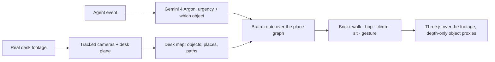

<div align="center">

# 🧱 Desk Buddy

### A little friend, on your actual desk.

A tiny **4 cm** companion that walks, explores, and gets your attention when it matters.

**[▶ Play on Google Cloud](https://storage.googleapis.com/desk-buddy-h2gdm-2689-20261016/index.html?v=2)** · **[Watch the demo](https://youtu.be/JXPQdz6Ttgs)** · [Quick start](#run-locally) · [Controls](#try-it) · [Architecture](#how-it-works)


*Clips from the running browser prototype. Live Three.js animation over real desk footage.*

**Google DeepMind AI Hackathon · pico banana · Hanbin Bae ([@anemptyship](https://cerebralvalley.ai/u/anemptyship))**

</div>

## Meet Bricki

What if your next notification walked over to you?

Bricki is an original, pocket-sized block-toy companion for an AR desk experience. It shares the space around your laptop, takes a break on its edge, and scrambles onto your coffee cup. When a message arrives, it comes closer and gives a little jump. When permission is needed, you choose **Allow** or **Later**.

- **Tiny physical presence:** 4 cm tall, with a 2.5 cm mode, breathing, blinking, and idle movement.
- **Places to explore:** desk walks, laptop-edge sitting, and a jump → hang → pull-up → sit sequence on the cup.
- **Interactive notifications:** message, permission, and urgent events change the running application state.
- **A reproducible demo:** cached footage, cameras, and voices; no API key required to play.

### A coffee-cup adventure


*Detail crop from the same live recording. Character scale is unchanged.*

## Try it

**[Open the live Google Cloud demo](https://storage.googleapis.com/desk-buddy-h2gdm-2689-20261016/index.html?v=2)** in a desktop Chrome browser, click **Meet Bricki**, and use the control panel or keyboard.

| Key | What happens |
| --- | --- |
| `1` | Climb the coffee cup and sit on its rim |
| `2` | Hop onto the bottle cap and drum on it |
| `3` | Sit on the MacBook's front edge |
| `4` | Stand on the wallet like a stage |
| `5` | Walk to the water bottle and point at it |
| `Q` `W` `E` `R` | Agent events: build finished · send the recap? · standup in 1 min · no water in 2 h |
| `Enter` / `Backspace` | Allow / Later |
| `G` | Show the desk map (object proxies and places) |

Type any agent event into the box to see how Bricki reacts. With a Gemini API key in the panel,
**Gemini 4 Argon** decides the urgency, which object to use and what to say; without one, keyword rules do.

## Run locally

Requirements: Node.js **22.12+** and pnpm.

```sh
git clone https://github.com/Anemptyship/desk-buddy.git
cd desk-buddy/player
pnpm install --frozen-lockfile
pnpm dev
```

Open the Vite URL printed in your terminal. To build and preview production:

```sh
pnpm build
pnpm preview
```

The checked-in runtime assets are ready to use. AI credentials are only needed when regenerating offline assets.

## How it works



The desk is a graph of places on real objects (cup rim, bottle-cap seat, laptop edge and palm rest,
wallet top, beside the water bottle) joined by how you get between them: walk, hop, climb, drop.
Bricki always leaves an object the way it got on, so an interruption never sends it through the cup.
Notifications ride on Bricki: a compact pill while it walks, a full card once it stops, and a card
with buttons freezes in place so Allow and Later never move under the cursor.

`desk-buddy perceive` asks Gemini 4 Argon to find the objects and what each affords in a few frames
of the take, raycasts its points onto the desk plane, and writes the map. The checked-in map is
hand-placed from raycast frame points and is labelled as such.

| Part | Implementation |
| --- | --- |
| Player | TypeScript, Vite, Three.js (`src/behavior`, `src/scene`, `src/character`, `src/render`, `src/agent`) |
| Desk understanding and decisions | Gemini 4 Argon (`pipeline/desk_buddy/perceive.py`, `player/src/agent/argon.ts`) |
| Scene preparation | Python, OpenCV, NumPy, SciPy, FFmpeg |
| Character design | Original Bricki reference developed with Nano Banana |
| Demo film | `video/`: frame-exact offline render of the same player, compositing, synthesized sound |
| Deployment | Static app on **Google Cloud Storage** |

## Repository guide

```text
player/src/              Brain, place graph, character, stage, Argon agent, live UI, offline renderer
player/public/scene/     Rectified desk video and synchronized scene data
player/public/audio/     Cached voice cues
pipeline/desk_buddy/     Offline camera and surface preparation
pipeline/tests/          Geometry and timestamp checks
docs/media/              Gameplay GIFs from the live recording
video/                   Demo film pipeline (see video/README.md)
scripts/deploy_gcs.py    Google Cloud Storage deployment helper
```

### Prepare another scene

```sh
uv sync
uv run desk-buddy --help
uv run pytest
```

See the [pipeline notes in Korean](docs/PIPELINE.ko.md) for calibration details. Keep credentials in an ignored `.env` file.

### Deploy to Google Cloud

Build the player, authenticate with Google Cloud Application Default Credentials, then create a **new dedicated bucket**:

```sh
python3 scripts/deploy_gcs.py \
  --project YOUR_PROJECT_ID \
  --bucket YOUR_UNIQUE_DEMO_BUCKET
```

The helper uploads `player/dist` and makes its demo assets publicly readable. It never uploads `.env`, original MOV metadata, or credentials. It intentionally stops if the bucket already exists. The deployment uses the static Vite build and needs no application server.

<details>
<summary><strong>Prototype scope and limitations</strong></summary>

The background is prerecorded. Object geometry, contact, shadows, and camera tracking are approximate; this is an AR interaction prototype rather than live headset tracking. Notifications are local demo events. The permission card changes demo state and does not request real device camera access.

The initial laptop calibration measured approximately 0.47 px reprojection RMS. This is a calibration diagnostic, not a claim about whole-scene accuracy or zero drift.

</details>

## Team & license

**pico banana — Hanbin Bae (@anemptyship)**

Original code is released under the [MIT License](LICENSE). Third-party libraries and media retain their respective rights.
