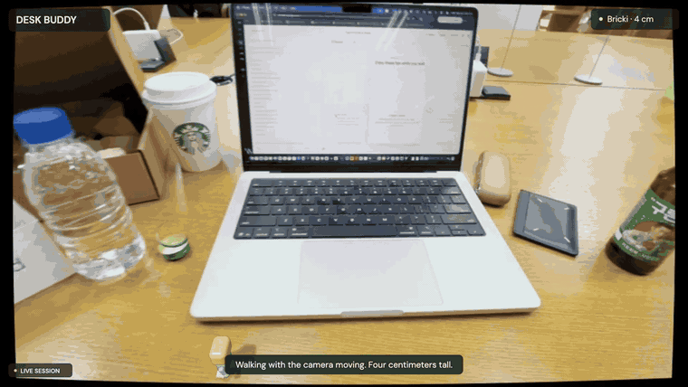
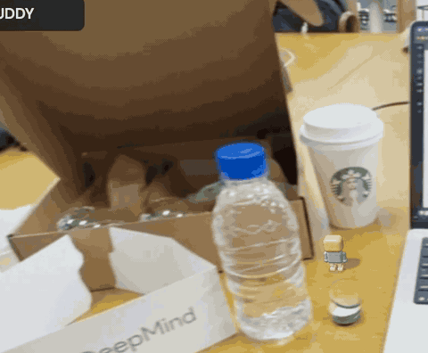
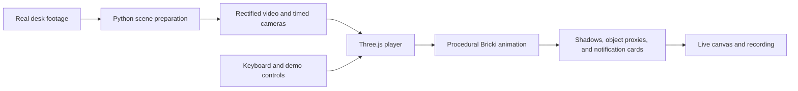

<div align="center">

# 🧱 Desk Buddy

### A little friend, on your actual desk.

A tiny **4 cm** companion that walks, explores, and gets your attention when it matters.

**[▶ Play on Google Cloud](https://storage.googleapis.com/desk-buddy-h2gdm-2689-20261016/index.html?v=2)** · [Quick start](#run-locally) · [Controls](#try-it) · [Architecture](#how-it-works)



*Clips from the running browser prototype. Live Three.js animation over real desk footage.*

**Google DeepMind AI Hackathon · pico banana · Hanbin Bae ([@anemptyship](https://cerebralvalley.ai/u/anemptyship))**

</div>

## Meet Bricki

What if your next notification walked over to you?

Bricki is an original, pocket-sized block-toy companion for an AR desk experience. It shares the space around your laptop, takes a break on its edge, and scrambles onto your coffee cup. When a message arrives, it comes closer and gives a little jump. When permission is needed, you choose **Allow** or **Later**.

- **Tiny physical presence:** 4 cm tall, with a 2.5 cm mode, breathing, blinking, and idle movement.
- **Places to explore:** desk walks, laptop-edge sitting, and a jump → hang → pull-up → sit sequence on the cup.
- **Interactive notifications:** message, permission, and urgent events change the running application state.
- **A reproducible demo:** cached footage, cameras, and voices; no API key required to play.

### A coffee-cup adventure



*Detail crop from the same live recording. Character scale is unchanged.*

## Try it

**[Open the live Google Cloud demo](https://storage.googleapis.com/desk-buddy-h2gdm-2689-20261016/index.html?v=2)** in a desktop Chrome browser, click **Meet Bricki**, and use the control panel or keyboard.

| Key | What happens |
| --- | --- |
| `1` | Walk across the desk |
| `2` | Sit on the laptop edge |
| `3` | Climb the cup and settle on its rim |
| `4` | Bring over a message |
| `5` | Ask for permission |
| `6` | Deliver an urgent reminder |
| `Enter` / `Backspace` | Allow / Later |
| `-` / `+` | Switch to 2.5 cm / 4 cm |
| `G` / `F1` | Inspect surface proxies / implementation information |

**Guided live demo** plays the interaction sequence. **Record live demo** captures 68 seconds of the actual rendered canvas with audio and downloads WebM.

## Run locally

Requirements: Node.js **22.12+** and pnpm.

```sh
git clone https://github.com/Anemptyship/desk-buddy.git
cd desk-buddy/player
pnpm install --frozen-lockfile
pnpm dev
```

Open the Vite URL printed in your terminal. To build and preview production:

```sh
pnpm build
pnpm preview
```

The checked-in runtime assets are ready to use. AI credentials are only needed when regenerating offline assets.

## How it works



A 14-inch MacBook Pro provides a metric scale anchor. The player synchronizes **506 camera samples** to video timestamps and renders a jointed character, surface shadows, and depth-writing laptop/cup proxies. Notifications and permission choices drive the animation state machine.

| Part | Implementation |
| --- | --- |
| Player | TypeScript, Vite, Three.js, Web Audio, MediaRecorder |
| Scene preparation | Python, OpenCV, NumPy, SciPy, FFmpeg |
| Character design | Original Bricki reference developed with Nano Banana |
| Character motion | Procedural geometry and joint animation in code |
| Voice cues | Cached macOS system speech |
| Deployment | Public static app on **Google Cloud Storage**, served over HTTPS |

Omni was explored for separate concept clips. The playable character and GIFs on this page come from the real-time player.

## Repository guide

```text
player/src/              Character, animation states, UI, and scene configuration
player/public/scene/     Rectified desk video and synchronized scene data
player/public/audio/     Cached voice cues
pipeline/desk_buddy/     Offline camera and surface preparation
pipeline/tests/          Geometry and timestamp checks
docs/media/              Gameplay GIFs from the live recording
scripts/deploy_gcs.py    Google Cloud Storage deployment helper
```

### Prepare another scene

```sh
uv sync
uv run desk-buddy --help
uv run pytest
```

See the [pipeline notes in Korean](docs/PIPELINE.ko.md) for calibration details. Keep credentials in an ignored `.env` file.

### Deploy to Google Cloud

Build the player, authenticate with Google Cloud Application Default Credentials, then create a **new dedicated bucket**:

```sh
python3 scripts/deploy_gcs.py \
  --project YOUR_PROJECT_ID \
  --bucket YOUR_UNIQUE_DEMO_BUCKET
```

The helper uploads `player/dist` and makes its demo assets publicly readable. It never uploads `.env`, original MOV metadata, or credentials. It intentionally stops if the bucket already exists. The deployment uses the static Vite build and needs no application server.

<details>
<summary><strong>Prototype scope and limitations</strong></summary>

The background is prerecorded. Object geometry, contact, shadows, and camera tracking are approximate; this is an AR interaction prototype rather than live headset tracking. Notifications are local demo events. The permission card changes demo state and does not request real device camera access.

The initial laptop calibration measured approximately 0.47 px reprojection RMS. This is a calibration diagnostic, not a claim about whole-scene accuracy or zero drift.

</details>

## Team & license

**pico banana — Hanbin Bae (@anemptyship)**

Original code is released under the [MIT License](LICENSE). Third-party libraries and media retain their respective rights.
